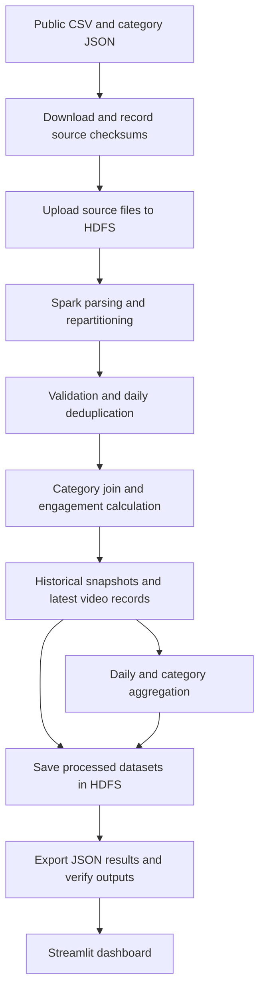

# YouTube Video Statistics

## Project Report

**Application:** YouTube Pulse

**Technologies:** Hadoop HDFS, Apache Spark, Python, Streamlit

**Report date:** 12 November 2026

**Repository:** [Avighn0611/BDA-youtube](https://github.com/Avighn0611/BDA-youtube)

## Abstract

This project implements a batch processing system for the analysis of historical YouTube trending statistics. The system stores publicly available video records in Hadoop Distributed File System (HDFS), processes them using Apache Spark, and presents the results through a Streamlit dashboard. The analysis covers views, likes, comments, category performance, and engagement across observation dates.

The India dataset contains 37,352 source records. After validation and daily deduplication, the pipeline retains 32,265 observations representing 16,305 distinct videos. Separate datasets are produced for historical observations, latest video statistics, daily activity, and category summaries. The recorded execution used two HDFS DataNodes and two Spark workers running as separate processes on one Mac. Both Spark executors completed tasks, and independent checks confirmed that the latest view, like, and comment counts matched the original CSV. The project demonstrates the integration of distributed storage, parallel processing, and an analytical interface within a reproducible workflow.

## 1. Introduction and problem statement

YouTube video statistics can be used to examine the relationship between content categories, audience reach, and interaction. However, trending datasets require careful interpretation. A video may appear on several dates, and each observation contains cumulative counters. Adding the views from every row would count the same video's earlier views repeatedly.

The project addresses this problem by distinguishing daily observations from unique videos. It maintains a cleaned history for trend analysis and selects the latest observation of each video for rankings and summary totals. Category identifiers are converted into readable labels, and engagement is calculated consistently across valid records.

The intended outcome is a working system that can ingest source files, process them through Hadoop and Spark, and make the results accessible through a user interface. The implementation uses a historical dataset; it does not collect live statistics or predict future video performance.

## 2. Objectives

The project objectives are to:

1. Store the source dataset and analytical outputs in HDFS with block replication.
2. Process the records using Spark DataFrames and SQL functions.
3. Validate records and remove duplicate daily observations.
4. Compare categories and videos using observed views, likes, comments, and engagement.
5. Provide interactive filters, charts, rankings, and CSV export.
6. Verify resource use across two Spark workers and independently check the analytical results.

## 3. Dataset and input specification

### 3.1 Source and coverage

The input is the public [Trending YouTube Video Statistics dataset by Mitchell J](https://www.kaggle.com/datasets/datasnaek/youtube-new). The reported analysis uses two files:

| File | Description |
|---|---|
| `INvideos.csv` | Observations of videos appearing on India's trending list |
| `IN_category_id.json` | Mapping between category identifiers and category names |

The original CSV contains 37,352 records. The retained observations span 14 November 2017 to 14 June 2018. Each row represents a video observed on a particular trending date. The same video may therefore occur in multiple rows.

The country label identifies the trending list from which the record was collected. The view, like, and comment counters are video-level counters; they do not represent traffic originating exclusively from India.

### 3.2 Fields used in the analysis

| Field | Purpose |
|---|---|
| `video_id` | Identifies a video across observations and supports deduplication |
| `trending_date` | Identifies the observation date for daily analysis and filtering |
| `title`, `channel_title` | Provide readable labels and support search |
| `category_id` | Connects each record to its category name |
| `publish_time` | Supports calculation of video age at observation |
| `views` | Provides the cumulative view count at the observation |
| `likes`, `comment_count` | Provide interaction counts for rankings and engagement |
| `comments_disabled`, `ratings_disabled` | Indicate restrictions affecting interpretation of engagement |
| `video_error_or_removed` | Preserves the source availability flag |

Descriptions, tags, thumbnail URLs, and dislike counts are present in the source but are not included in the current analytical outputs. File sizes, checksums, and the source URL are recorded during data acquisition. The source files are downloaded separately and excluded from the Git repository.

## 4. System design

### 4.1 Technology selection

| Component | Version | Responsibility |
|---|---|---|
| Hadoop HDFS | 3.3.6 | Storage of source files and processed datasets |
| Apache Spark / PySpark | 3.5.7 | Distributed transformations, joins, window operations, and aggregation |
| Java | 11 | Runtime for Hadoop and Spark services |
| Python | 3.11 | Processing scripts, orchestration, validation, and interface logic |
| Streamlit | 1.50.0 | Browser-based dashboard |
| Plotly | 6.3.1 | Interactive charts |
| pandas | 2.3.3 | Dashboard filtering and independent result verification |

HDFS and Spark perform separate functions. HDFS stores file blocks and their replicas. Spark reads those blocks, processes the records, and writes the results back to HDFS. The implementation uses Spark's standalone cluster manager; Hadoop MapReduce and YARN are not part of this setup.

### 4.2 Node roles

| Logical node | Services |
|---|---|
| Master | HDFS NameNode, Spark master, application driver, and dashboard |
| Worker 1 | HDFS DataNode 1 and Spark worker 1 |
| Worker 2 | HDFS DataNode 2 and Spark worker 2 |

The NameNode maintains filesystem metadata, including file names and block locations. DataNodes store the file blocks. Clients obtain block locations from the NameNode and transfer file contents directly to or from the DataNodes.

The Spark master allocates executor resources to the application. The driver coordinates the analysis and schedules tasks. Worker processes launch executors, which perform the assigned computations.

The verified configuration runs on an Apple-silicon Mac with 8 GB RAM. The two logical workers use separate ports, storage directories, logs, and process IDs. They communicate over the local network interface. This demonstrates separate node processes on one physical host; execution across three physical computers has not been verified.

### 4.3 Pipeline flow



*Figure 1. Data flow from source files to the analytical interface.*

## 5. Implementation and processing methodology

### 5.1 Data acquisition and ingestion

`scripts/download_data.py` downloads the dataset archive and extracts the selected country's CSV and category JSON into `data/raw/`. The default country is India. Other supported country files can be processed individually, but the results presented in this report refer only to the India run.

`scripts/run_pipeline.py` uploads the input files to `/youtube/raw/` in HDFS. The cluster uses a replication factor of 2, placing a copy of each input block on both DataNodes. Replication is checked before analysis begins.

### 5.2 Parsing and validation

The Spark application reads the CSV from HDFS with an explicit input schema. Quoted text and multiline fields are supported. Multiline CSV input initially occupies one file partition; the application then repartitions the records into four partitions for subsequent processing.

Trending dates are parsed using `yy.dd.MM`. For example, `17.14.11` becomes `2017-11-14`. Publication timestamps are parsed with the Spark session configured for UTC. Numeric fields and source flags are converted to their corresponding numeric and Boolean types.

The validation stage excludes records with invalid video identifiers, invalid trending dates, missing required counters, or negative view, like, or comment counts. Category IDs without a matching label are retained as `Unknown`.

### 5.3 Duplicate handling

Daily duplicates are identified using the key `(country, video_id, trending_date)`. A Spark window retains one row per key, ordering by views, likes, and comments in descending order, followed by title in ascending order.

Records for the same video on different dates remain in the historical dataset. A second window selects the most recent observation per country and video to produce the latest-video dataset.

For example, a video observed with 1,000 views on one day and 1,500 views on the following day contributes 1,500 views to the latest-video total. Summing the two observations would incorrectly report 2,500 views. The dashboard repeats this latest-observation selection within the chosen date range.

### 5.4 Category enrichment and engagement

The category JSON is converted into a lookup table and broadcast to the executors. A left join attaches the category name to each valid observation without discarding unmatched records.

Engagement is defined as:

```text
Engagement (%) = 100 × (likes + comment_count) / views
```

An illustrative record with 10,000 views, 500 likes, and 100 comments has an engagement value of 6%. Engagement is left missing when views are zero or ratings are disabled. Records with disabled comments remain in the analysis, although their measured engagement may be lower because comments are unavailable.

This metric expresses interactions relative to views. It is not a percentage of unique viewers, and multiple comments from one user are possible. Category comparisons use median engagement to reduce the influence of unusually large ratios.

The output also includes `days_to_trend`, calculated as the difference between the observation date and publication date. Despite the field name, it measures video age at that observation, not necessarily the delay before the video's first appearance on a trending list.

### 5.5 Aggregation and output storage

Spark produces daily summaries grouped by country, category, and trending date. These contain the number of observed videos, the sum of their observed view counters, and median engagement. Category summaries are calculated from the latest-video dataset and include video counts, views, likes, median views, and median engagement.

The cleaned snapshots are saved in Parquet format, and the analytical datasets are also written as JSON. Spark reads the saved Parquet data back and verifies its record count. The orchestration script subsequently exports the HDFS JSON files into local files for the dashboard.

### 5.6 Spark resource allocation

Resource allocation and task scheduling are handled separately. The Spark master tracks worker capacity and allocates executors. The driver then assigns tasks to those executors.

| Setting | Configured value |
|---|---|
| Capacity advertised by each worker | 1 core and 768 MiB of executor-memory budget |
| Resources requested per executor | 1 core and a 512 MiB Java heap |
| Application executor-core limit | 2 cores |
| Driver Java heap | 768 MiB |
| Deployment mode | Client |
| Explicit repartitioning and SQL shuffle partitions | 4 each |

With both workers available, one executor is allocated to each worker. Under the default one-CPU-per-task setting, two tasks can execute concurrently. A stage with four tasks therefore requires further tasks to wait until an executor slot becomes available. The same executors process tasks from subsequent stages until the application completes.

Core settings control Spark concurrency rather than reserving exclusive physical CPU cores. Heap settings do not include all process memory: Python, native libraries, Hadoop services, and the operating system require additional memory.

## 6. Outputs and user interface

### 6.1 Processed datasets

For the India run, outputs are stored under `/youtube/results/IN/` in HDFS.

| Output | Record level | Contents |
|---|---|---|
| `cleaned_parquet/` | One video observation | Typed and deduplicated historical data |
| `snapshots/` | One country/video/date | Counters, labels, flags, engagement, and video age |
| `latest/` | One country/video | Most recent observation and associated statistics |
| `daily/` | One country/category/date | Trending-video count, observed views, and median engagement |
| `categories/` | One country/category | Video count, observed views and likes, median views, and median engagement |

Each output directory contains Spark partition files. The four JSON datasets are exported to `artifacts/` as line-delimited JSON files. Run metadata, cluster reports, block locations, and executor task counts are retained as execution evidence.

### 6.2 Dashboard

The dashboard provides four views:

- **Category insights:** observed views and median engagement by category.
- **Trending activity:** daily counts of distinct trending videos and daily median engagement.
- **Video explorer:** searchable video records, rankings, and filtered CSV export.
- **Cluster and methodology:** live node counts, saved task evidence, and metric definitions.

The interface also displays unique-video counts, latest observed views, latest observed likes, and median engagement. Users can filter by observation date, category, title or channel text, and minimum latest observed views.

The dashboard uses pandas to summarize the exported Spark-cleaned records. Changing a filter does not launch another Spark job. New input data must be processed through the batch pipeline before it appears in the interface.

## 7. Results and discussion

### 7.1 Processing results

The recorded run was completed on 12 November 2026 using Spark application `app-20261112121917-0000`.

| Measure | Result |
|---|---:|
| Source records | 37,352 |
| Invalid or duplicate daily records removed | 5,087 |
| Retained daily observations | 32,265 |
| Distinct videos | 16,305 |
| HDFS DataNodes participating | 2 |
| Spark executors completing tasks | 2 |
| Completed tasks on executor 0 | 29 |
| Completed tasks on executor 1 | 31 |
| Failed tasks in the saved event log | 0 |

The recorded Spark application duration was 16.86 seconds. This excludes installation, dataset download, HDFS upload, and dashboard startup. It is a measurement from one local execution, not a comparison against another processing system.

### 7.2 Observed video statistics

Using one latest observation for each of the 16,305 videos, the processed dataset contains:

| Measure | Value |
|---|---:|
| Sum of latest observed views | 11,141,683,702 |
| Sum of latest observed likes | 235,372,506 |
| Sum of latest observed comments | 24,150,695 |
| Median video engagement | 0.86% |

These values summarize cumulative counters observed in the sample. The latest observations occur on different dates for different videos. The totals do not represent views or interactions gained during the study period, nor a synchronized measurement of all videos on the final date.

The five categories with the highest observed view totals are shown below. View counts are expressed in millions; engagement values are rounded to two decimal places.

| Category | Distinct videos | Latest observed views (millions) | Median engagement (%) |
|---|---:|---:|---:|
| Entertainment | 7,546 | 4,337.55 | 0.59 |
| Music | 1,213 | 2,447.69 | 1.90 |
| Film & Animation | 522 | 937.25 | 1.59 |
| Comedy | 1,114 | 798.80 | 4.22 |
| News & Politics | 2,505 | 744.88 | 0.68 |

The category table is derived from the saved Spark category output, which uses approximate medians. The overall engagement value is calculated directly from the latest-video export, consistent with the dashboard.

Entertainment accounts for approximately 38.93% of the observed view total. The five categories in the table account for 83.17% combined. Comedy has the highest median engagement among these five categories despite having a lower view total than Entertainment and Music. This illustrates why view totals and engagement ratios answer different analytical questions.

There are 69 videos whose category could not be resolved from the supplied lookup; these remain under `Unknown`. Category differences describe the sampled videos and do not establish that a category causes higher reach or engagement.

## 8. Testing and validation

Validation was performed at the analytical, storage, execution, and interface levels.

| Check | Method | Recorded outcome |
|---|---|---|
| Analytical correctness | Four Spark tests covering duplicate handling, invalid data, engagement edge cases, and country isolation | Passed |
| Independent result comparison | pandas reconstruction from the original CSV; comparison of video IDs and every latest view, like, and comment count | Matched |
| Output persistence | Read saved HDFS Parquet data and compare its row count | 32,265 rows matched |
| Storage integrity | HDFS filesystem check and block-location inspection | Healthy input files with replicas on both DataNodes |
| Distributed task execution | Parse the saved Spark event log | Tasks completed by both executors |
| Dashboard behavior | Streamlit test of initial loading, category filtering, sorting, empty search, and reset | Passed |
| Service lifecycle | Stop and restart the project services | HDFS data preserved |

Five automated tests passed in total: four analytical tests and one dashboard interaction test. The pandas comparison, HDFS checks, event-log inspection, and restart verification provide additional evidence beyond those tests.

The recorded verification summary is available in [docs/VERIFICATION.md](docs/VERIFICATION.md). Task counts and executor information are available in [docs/execution-evidence.json](docs/execution-evidence.json). The result tables in this report were calculated from the saved outputs of that run; a new Spark run was not performed solely to prepare the report.

## 9. Limitations and future scope

The current deployment uses one physical host. Separate worker processes demonstrate cluster coordination, but they do not establish execution across three physical PCs. Likewise, HDFS replicas stored on the same computer do not protect against physical host or disk failure. Deployment on separate machines requires reachable addresses, consistent software environments, port configuration, and verification on the actual network.

The dataset covers a historical trending sample rather than the full YouTube catalogue. Videos absent from the trending list are outside the analysis. Disabled comments or ratings affect the interpretation of engagement, and changes in daily charts may result from changes in sample composition.

The input is small enough to process on a single computer. No distributed speedup or large-scale performance claim is made. Dashboard exports are loaded into local memory, which would need to be reconsidered for substantially larger datasets.

Further development could include a verified three-machine deployment, testing with larger datasets, scheduled ingestion, and a query service for the dashboard. Any live-data extension would require a separate collection process and appropriate handling of API limits and changing field availability.

## 10. Conclusion

YouTube Pulse implements a complete batch pipeline from public source files to an interactive analytical interface. HDFS stores the input and processed datasets, Spark performs validation and analysis across two executors, and Streamlit presents the saved results.

The main processing decisions are the separation of historical snapshots from latest-video records, consistent treatment of engagement, and independent validation of the outputs. The recorded run demonstrates functioning storage replication, task execution on both workers, and correct reproduction of the source counters. The current system is suitable for demonstrating these mechanisms on one host, with physical multi-machine deployment remaining a separate verification step.

## Appendix A. Execution procedure

The initial setup requires Java 11, Python 3.11, Git, curl, and tar. From a fresh checkout:

```bash
git clone https://github.com/Avighn0611/BDA-youtube.git
cd BDA-youtube
bash scripts/setup.sh
bash run.sh --refresh
```

For an existing installation, `bash run.sh` starts the services and uses saved results. The `--refresh` option additionally performs ingestion, analysis, validation, and evidence collection.

| Interface | Local address |
|---|---|
| Dashboard | http://127.0.0.1:8501 |
| HDFS NameNode | http://127.0.0.1:9870 |
| Spark master | http://127.0.0.1:8080 |
| Spark application | http://127.0.0.1:4040 while the job runs |

To inspect the cluster, rerun the tests, and stop the services:

```bash
.venv/bin/python scripts/cluster.py status
.venv/bin/python -m pytest tests -q
.venv/bin/python scripts/verify_results.py
.venv/bin/python scripts/collect_evidence.py
.venv/bin/python scripts/cluster.py stop
```

Detailed commands and the repository file map are provided in the [README](README.md). The [demonstration guide](docs/DEMO_GUIDE.md) describes the presentation sequence, and the [multi-machine guide](docs/MULTI_MACHINE.md) documents the changes required for separate hosts.

## References

1. Mitchell J. [Trending YouTube Video Statistics](https://www.kaggle.com/datasets/datasnaek/youtube-new). Kaggle dataset.
2. Apache Software Foundation. [Hadoop 3.3.6: Single Node Setup](https://hadoop.apache.org/docs/r3.3.6/hadoop-project-dist/hadoop-common/SingleCluster.html).
3. Apache Software Foundation. [Spark 3.5.7: Cluster Mode Overview](https://spark.apache.org/docs/3.5.7/cluster-overview.html).
4. Apache Software Foundation. [Spark 3.5.7: Standalone Mode](https://spark.apache.org/docs/3.5.7/spark-standalone.html).
5. Apache Software Foundation. [Spark 3.5.7: Submitting Applications](https://spark.apache.org/docs/3.5.7/submitting-applications.html).
6. Streamlit. [Streamlit Documentation](https://docs.streamlit.io/).
