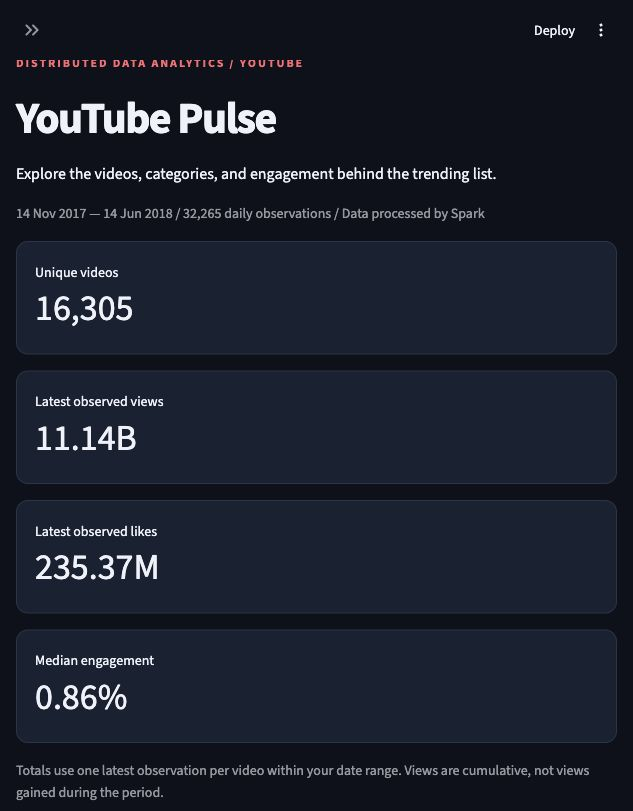
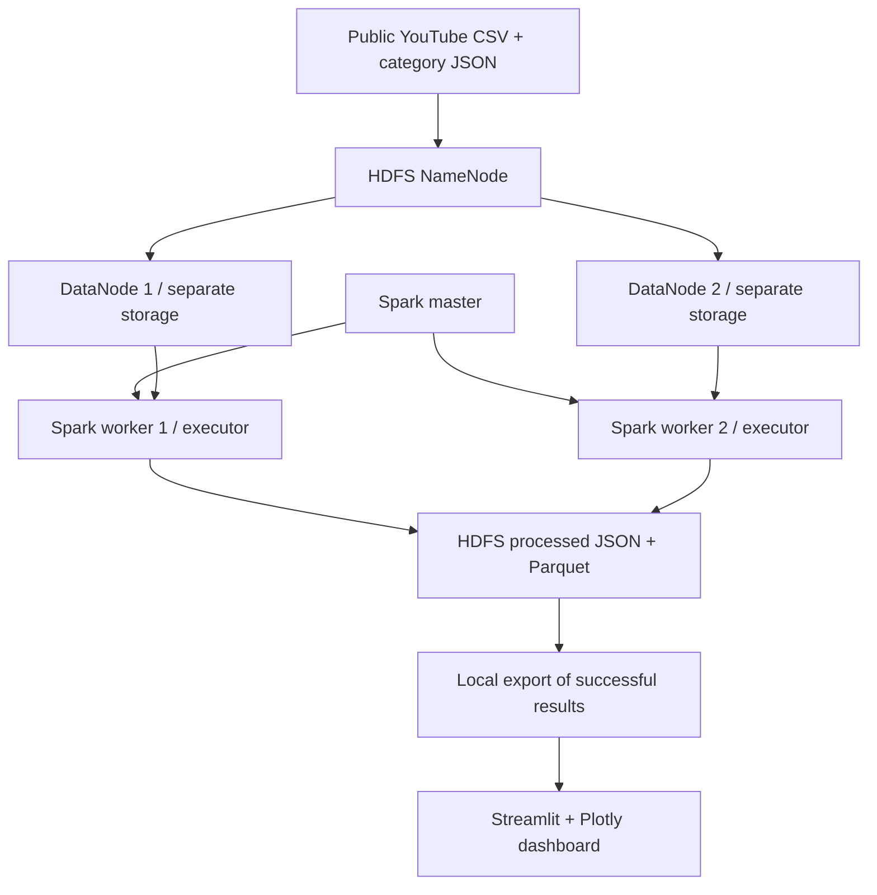

# YouTube Pulse — YouTube Video Statistics

A working Hadoop HDFS + Apache Spark analytics project with a Streamlit dashboard. It analyzes historical YouTube trending snapshots from a public Kaggle dataset.



**Deployment:** one physical Mac, one logical master, two logical workers. This is a single-host demonstration, not a verified three-PC deployment. The course's three-PC requirement still needs a physical deployment or instructor acceptance of this alternative.

## Features

- Two real HDFS DataNode processes with separate directories and ports; replication factor 2.
- Spark standalone master and two separate workers, one core each.
- PySpark cleaning, window-based deduplication, category joins, daily aggregates, and category rankings.
- HDFS CSV inputs and JSON/Parquet outputs; dashboard exports are read back from HDFS.
- Date/category/search/view filters, charts, video rankings, and CSV downloads.
- Live cluster status, persisted Spark event logs, HDFS replication evidence, and independent validation.

## Start on the current Mac

Open Terminal in this repository. Dependencies and data are already installed if you received the completed workspace.

```bash
cd "/Users/dhruv/Desktop/BDA project"
.venv/bin/python scripts/cluster.py start
.venv/bin/python scripts/cluster.py dashboard
```

Open **http://127.0.0.1:8501**. Existing processed results load immediately. To rerun the real distributed analysis:

```bash
.venv/bin/python scripts/run_pipeline.py
.venv/bin/python scripts/verify_results.py
.venv/bin/python scripts/collect_evidence.py
```

Run only one pipeline at a time. Logs are written to `artifacts/pipeline.log`; a complete job can take a few minutes depending on memory pressure. Close memory-heavy applications during the demo.

Shortcut: `bash run.sh` starts the cluster and dashboard using saved results. `bash run.sh --refresh` also reruns ingestion, Spark analysis, validation, and executor evidence collection.

## Install on a fresh Mac

Prerequisites: Java 11, Python 3.11, curl, tar, and Git. With Homebrew already installed, Python can be installed using `brew install python@3.11`; install an ARM64 Java 11 distribution on Apple silicon. Verify `java -version` and `python3.11 --version` first.

```bash
bash scripts/setup.sh
.venv/bin/python scripts/download_data.py --country IN
.venv/bin/python scripts/cluster.py start
.venv/bin/python scripts/run_pipeline.py --country IN
.venv/bin/python scripts/verify_results.py
.venv/bin/python scripts/cluster.py dashboard
```

`setup.sh` downloads Hadoop 3.3.6 and verifies Apache's SHA-512 checksum before extraction. It installs pinned Python dependencies, including Spark/PySpark 3.5.7. Hadoop and the Python environment live in `~/.cache/youtube-pulse`; `.runtime` and `.venv` are local symlinks. Project data stays inside the project directory. No VMs, Docker, global Python packages, or SSH server are needed.

If the Apache archive is slow, download the same archive from a mirror into `~/.cache/youtube-pulse/downloads/hadoop-3.3.6.tar.gz`. The setup script still verifies it against Apache's checksum. A failed checksum usually means a partial download: remove that archive and retry.

## System architecture



The NameNode manages metadata. DataNodes store blocks. The Spark master assigns executor resources; the application driver plans work and executors run tasks. HDFS is the Hadoop component used here; YARN and Hadoop MapReduce are not used.

## Data and metric definitions

Source: [Trending YouTube Video Statistics, Mitchell J](https://www.kaggle.com/datasets/datasnaek/youtube-new). Default inputs: `INvideos.csv` and `IN_category_id.json`. The download script also supports US, GB, CA, DE, and FR individually. This is a historical dataset, not a live YouTube API integration. Dataset rights and license remain those of the source; source files are excluded from Git.

- A raw row is a video observed on a country's trending list on a particular date.
- Parse dates as `yy.dd.MM`, timestamps as UTC, and counters as integers.
- Reject invalid video IDs, invalid trending dates, missing counters, and negative counters.
- Deduplicate `(country, video_id, trending_date)`, preferring the highest view count, then likes, comments, and title.
- For video totals, select each video's latest observation in the selected period. **Do not sum cumulative counts across days.**
- Engagement percentage = `100 * (likes + comment_count) / views`. It is null for zero views or disabled ratings. This is an interaction ratio, not a unique-person percentage; it is not guaranteed to be at most 100%.
- Category comparisons display median video engagement. Comments-disabled videos can have lower measured engagement; they remain identifiable in cleaned data.
- The date filter selects observation dates. It does not measure views gained within that interval.
- Country identifies the trending list, not the geographical source of views. YouTube counters are global video counters.
- The pipeline writes daily/category analytical tables in Spark. The UI also filters and summarizes the exported cleaned snapshots with pandas for responsive interaction.
- Multiline CSV parsing starts with a single file partition. Explicit repartitioning distributes the downstream transformations across both executors.

Changing country replaces the dashboard's active export with that country's run. Cross-country totals are deliberately not combined.

## Controls and evidence

| Service | Address |
|---|---|
| Dashboard | http://127.0.0.1:8501 |
| HDFS NameNode UI | http://127.0.0.1:9870 |
| Spark master UI | http://127.0.0.1:8080 |
| Spark worker UIs | http://127.0.0.1:8081 and http://127.0.0.1:8082 |
| Spark application UI | http://127.0.0.1:4040 while a job runs |
| HDFS RPC / Spark master RPC | 9000 / 7077 |
| DataNode 1 data / IPC / HTTP | 9866 / 9867 / 9864 |
| DataNode 2 data / IPC / HTTP | 9886 / 9887 / 9884 |

```bash
.venv/bin/python scripts/cluster.py status
.venv/bin/python scripts/cluster.py hdfs dfsadmin -report
.venv/bin/python scripts/cluster.py hdfs fsck /youtube/raw -files -blocks -locations
.venv/bin/python scripts/cluster.py hdfs dfs -ls /youtube/results/IN
.venv/bin/python scripts/cluster.py stop
```

`stop` stops only project-owned processes, including the dashboard, and keeps HDFS data. `start` is idempotent and never reformats an existing filesystem. Services bind to loopback for this single-host demo. Two copies on the same Mac do not protect against physical disk or host failure.

Generated evidence is stored in `artifacts/`: run metadata, pipeline log, HDFS node/block reports, cluster snapshot, validation result, and exported datasets. Spark event logs remain in HDFS `/youtube/events`. Runtime service logs are in `.runtime/state/logs`.

## Tests

```bash
.venv/bin/python -m pytest tests -q
.venv/bin/python scripts/verify_results.py
```

Spark tests cover duplicate snapshots, latest-observation totals, invalid data, zero-view engagement, disabled ratings, and country isolation. Independent pandas verification compares every latest video's views, likes, and comments against the original CSV and checks the HDFS round-trip row count. See `docs/VERIFICATION.md` for results from the completed run.

## Repository map

| File | Responsibility |
|---|---|
| `scripts/setup.sh` | Install isolated dependencies and verify Hadoop archive |
| `scripts/cluster.py` | Generate HDFS configs; start, inspect, and stop services |
| `scripts/download_data.py` | Download public dataset and record checksums |
| `scripts/run_pipeline.py` | Ingest CSV into HDFS and submit Spark job |
| `pipeline/analyze.py` | Distributed cleaning and analytics |
| `dashboard/app.py` | Interactive dashboard |
| `scripts/verify_results.py` | Independent result comparison |
| `tests/test_analysis.py` | Analytical correctness tests |
| `docs/DEMO_GUIDE.md` | Demo steps, explanation, and viva preparation |
| `docs/MULTI_MACHINE.md` | Physical cluster migration checklist |

## GitHub submission

Commit source, docs, and selected evidence screenshots. Do not commit runtimes, virtual environments, the full downloaded dataset, or secrets. Create an empty GitHub repository, then publish this repository:

```bash
git remote add origin https://github.com/YOUR_USERNAME/youtube-pulse.git
git push -u origin main
```

Replace the example URL with your actual repository URL. Use a repository your evaluator can access. Include team names and actual contributions before submission. A repository URL is only a submission link after the push succeeds.

## References

- [Hadoop single-node setup](https://hadoop.apache.org/docs/r3.3.6/hadoop-project-dist/hadoop-common/SingleCluster.html)
- [Spark standalone clusters](https://spark.apache.org/docs/3.5.7/spark-standalone.html)
- [Spark application submission](https://spark.apache.org/docs/3.5.7/submitting-applications.html)
- [Streamlit documentation](https://docs.streamlit.io/)
